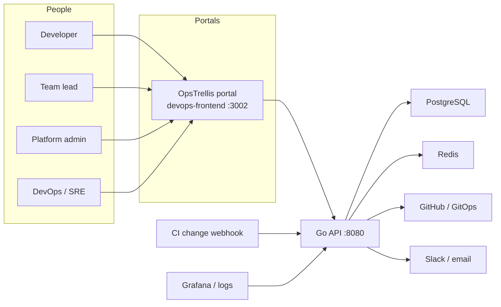

# OpsTrellis

[](https://go.dev/)
[](https://nextjs.org/)
[](./docs/FEATURES.md)
[](./docs/API.md)

OpsTrellis is the control plane for **infrastructure requests**, **approvals**, **application deploys**, **on-call**, **IAM access**, **maintenance windows**, and **post-release health**.

One portal (`devops-frontend`). One Go API. One Postgres record for a request, a Change Request (`CHG…`), an Incident (`INC…`), a Problem, or a Maintenance window (`MNT…`). IAM access requests (`AR-…`) stay in memory until the API restarts.

The display name is **OpsTrellis**. GitHub check IDs still use `infragate/*`.

---

## Documentation (start here)

Two repo docs list **everything**. Open these before Notion or deploy guides.

| Doc | What it contains | File |
| --- | --- | --- |
| **Current flows** | On-call, IAM, change, incident, problem, maintenance, and webhooks, step by step | [docs/FLOWS.md](./docs/FLOWS.md) |
| **All features and how they work** | Every shipped feature, who uses it, the flow, and the page | [docs/FEATURES.md](./docs/FEATURES.md) |
| **Full API reference** | Every HTTP route: method, auth, query/body, what it does | [docs/API.md](./docs/API.md) |

Notion (product narrative and BRDs):

| Document | Link |
| --- | --- |
| Portal Features and Flows (parent hub) | https://app.notion.com/p/3e50f430ed10816699fec83b1b270288 |
| Change Request, Incidents, and Health | https://app.notion.com/p/3e50f430ed1081adb731c7f64bdfa1b2 |

Operators: [docs index](./docs/README.md) · [Architecture](./docs/ARCHITECTURE.md) · [Deployment](./docs/DEPLOYMENT.md) · [CI/CD](./docs/CICD.md)

---

## Clear picture of the system



---

## All features (how they work)

Step-by-step for the live screens: **[docs/FLOWS.md](./docs/FLOWS.md)**. Full catalog: **[docs/FEATURES.md](./docs/FEATURES.md)**. Compact list below.

### Two paths

**Infra ticket.** User picks project + template → optional team-manager approval → DevOps review → GitOps PR (`request.json`) → promote `dev → uat → prod` → K8s / Health / rollback.

**App deploy.** Merge to `main` → `POST /api/webhooks/change` (optional SBOM / attestation / digest) → `CHG…` → Health watch → Grafana `POST /api/webhooks/alerts` or watcher spike → `INC…` linked to the CHG. Ack/resolve can sync to PagerDuty or Grafana IRM. DevOps can also file a CHG by hand.

**Identity.** The portal can sign in with OIDC. CI can prove GitHub Actions or GitLab OIDC at `POST /api/auth/workload/github` and `POST /api/auth/workload/gitlab`, then assume `AWS_WORKLOAD_ROLE_ARN` (repo as subject). Cloud secrets are not stored. Agents use `POST /mcp` with an API key for catalog reads plus `comment_incident` / `request_rollback`.

**On-call, IAM, maintenance.** On-call is a calendar plus onboard-project and cover requests. IAM is an `AR-…` request that a DevOps approver accepts; the grant waits for the access-file callback. Maintenance is a window that the creator’s manager, a DevOps manager, and an admin each approve or reject. Detail: [docs/FLOWS.md](./docs/FLOWS.md).

### One portal (`devops-frontend/` · :3002 · token `devops_token`)

Requesters, operators, managers, and admins share this shell. Grants hide the sections they cannot use. There is no Sign up page.

### Requests (same portal)

| Feature | How it works |
| --- | --- |
| Login / signup / verify / 2FA / reset | Account lives in Postgres. Token stored as `token`. Must be on a team to use the app. |
| New request | Catalog of golden paths first. Form is a separate page. `POST /api/request`. Cost estimate + guardrail before submit. |
| My requests | Status: pending manager → pending DevOps → in progress → done. Team leads see a manager-approval badge. |
| Projects / teams | Only projects the user can see. Team leads can add members. |
| Changes (read) | CHGs on visible projects. Unmapped CHGs (no `project_id`) are hidden. Users never create CHGs. |
| Incidents (read) | Assigned to the user **or** on a visible project. Users never create INCs. |
| Templates / saved configs / notifications / search / copilot | Helpers around the request path. |

### Portal Access (admins, same portal)

| Feature | How it works |
| --- | --- |
| Users / teams / SSO / access review / ownership | IAM. Create portal users and DevOps users. People → SSO turns on OIDC. |
| Requests / approval center / SLA | Full request list. Approve, reject, reassign, bulk status. |
| Projects / templates / maintenance | Catalog authors and legacy bundle cleanup. |
| Outbound + inbound webhooks | Slack/HTTP destinations and extra inbound secrets. |
| Changes / Incidents (read) | Full catalogs. Admin does not own the queue. |
| Deploy intel feed | Read-only briefs. |

### Operations and infrastructure (same portal)

| Feature | How it works |
| --- | --- |
| Requests / my tickets / workload | Manager queue. Approve opens the GitOps PR. |
| Approvals (queue, history, rules, timing) | Who must sign, how long it sat, high-risk merge ack. |
| Changes | Catalog + **New change**. Resolve, close, fail, cancel, reopen. Canary / 10 / 50 / 100 rollout. Preview and flag types. Clean watch auto-resolves. Open linked incidents block resolve/close. |
| Services | Separate catalog. Created services populate the CHG dropdown and fill omitted webhook env. |
| Calendar / release notes / change risk | Planned windows and weekly notes from closed CHGs. |
| Incidents / problems / workspace | Manual pages plus Grafana. A record page, not a form dump. Known error is a checkbox on an existing problem. The first time an incident is major, today’s on-call roster is paged. SEV1/SEV2 still pages the scorecard team. |
| Health / SLO / Identity | Watch window, baseline vs latest, rollback hint, DORA. Burned SLO writes a deploy freeze. Identity flags static keys, last cloud-role exchange, and OIDC verifies. |
| Scorecards / Evidence / Policies | Per-service health score, including live-vs-last-CHG drift. 30-day evidence pack. Lightweight Rego deny on CHG and request.json (`infragate/policy`). |
| Promotions / freezes / rollback | Env promotion with gates. Each hop writes a CHG. Freeze blocks risky ships. **NF-05:** shared guarded confirm on promote, rollback prepare, K8s day-2, and cloud disable — see [FEATURES.md](./docs/FEATURES.md). |
| Environment catalog (NF-03) | `/environments` + ScopeBar env names from `GET /api/devops/environment-catalog`. |
| Operator audit (NF-04) | `/activity` — `GET /api/devops/operator-activity`; ticket/cloud detail embed recent events. |
| Deploy intel | Onboard repo → open PRs + change brief + `infragate/deploy-intel` check. |
| GitOps control | Which repo/path gets `request.json`. |
| Kubernetes workspace (NF-02) | Cluster catalog → scoped workspace (overview + resource tabs); logs/terminal/rollout as drill-down. **Secure connect:** AWS/Azure/GCP IAM or workload identity, server `secret_ref`, encrypted kubeconfig/token — see [CONFIGURATION.md](./docs/CONFIGURATION.md#kubernetes-cluster-connections-devops). |
| **Cloud workspace** (NF-01 + BRD-07) | **Accounts:** managers onboard AWS/Azure/GCP (trust on API host). **Inventory:** read-only resources by team/account/env/region; account landing + resource detail. Operators read; User/Admin do not browse inventory. See [FEATURES.md](./docs/FEATURES.md). |
| On-call | Calendar, onboard project, day click shows team and users, cover request emails both people. |
| IAM access | `AR-…` request. DevOps approves. Grant and email wait for `POST /api/webhooks/iam-access`. |
| Maintenance | List plus Create. Manager, then DevOps manager, then admin. Approve and Reject on the current step. |
| Webhooks | Filterable inbound sources. Sample shows one example and never the secret. |
| Runbooks / access exceptions / secrets / retries / alerts | Day-2 ops. |

### Inbound (no form)

| Feature | How it works |
| --- | --- |
| Change webhook | CI after merge. Idempotent `repo+sha+env`. Omit environment. |
| Alert webhook | Grafana / Alertmanager / logger. Same fingerprint = same INC. |
| IRM webhook | PagerDuty / Grafana IRM / Opsgenie ack-resolve on the same INC. |
| Flag webhook | LaunchDarkly / Unleash / Flagsmith creates a `flag` CHG. |
| OTLP metrics | `POST /api/otlp/v1/metrics` feeds Health p95/error for watching CHGs. |
| MCP | `POST /mcp` catalog reads plus `comment_incident` / `request_rollback`. Bearer API key. Never applies terraform/kubectl. |
| Watch metrics | Push latency/error samples into Health. |
| Infra CI / GitHub / Slack / Teams | Plan output, intel briefs, ChatOps. |

---

## All APIs

Full contract (auth, bodies, errors): **[docs/API.md](./docs/API.md)**.

Auth: User / Admin / DevOps send `Authorization: Bearer …`. Admin may send `X-Admin-Secret`. Webhooks send `X-CI-Secret` or `X-Hub-Signature-256`. Unsigned webhooks are **401**. Do not mix portal tokens.

### Public

`GET /health` · `GET /ready` · `GET /swagger.json` · `GET /api-docs`

### Auth and `/api/me`

`POST /api/auth/signup` · `login` · `forgot-password` · `reset-password` · `verify-2fa`  
`GET /api/public/sso/options` · `GET /api/auth/oidc/start` · `GET /api/auth/oidc/callback` · `POST /api/auth/workload/github` · `POST /api/auth/workload/gitlab`  
`GET /mcp` · `POST /mcp`  
`GET /api/verify-email` · `POST /api/verify-otp` · `POST /api/resend-verification`  
`GET /api/me` · `/api/me/workspace` · `/api/me/2fa` · `/api/me/api-keys` · `/api/me/notifications` · `/api/me/notification-preferences`  
`POST /api/change-password`

### User requests and catalogs

`POST /api/request` · `GET /api/request/:id` · `POST /create-pr`  
`GET /api/history` · `/api/history/:id` · `/api/stats` · `/api/search` · `/api/golden-paths` · `/api/cost-guardrail` · `POST /api/cost-estimate` · `POST /api/copilot` (grounded citations)  
`GET /api/templates` · `/api/templates/:id` · `/api/logs/cloud` · `/api/logs/github`  
`GET /api/me/projects` · `/api/me/teams` · `/api/me/managed-teams` · `/api/me/changes` · `/api/me/incidents` · `/api/me/scorecards` · `/api/me/saved-configs` · `/api/me/pending-manager-approval`

### Admin

`/api/admin/users` · `/teams` · `/requests` (+ approve/reject/status/reassign/bulk) · `/stats` · `/dashboard-stats` · `/analytics/requests` · `/sla-breach-check` · `/notifications` · `/audit-log` · `/access-review` · `/team-ownership` · `/user-activity`  
`/api/admin/projects` · `/project-analytics` · `/templates` · `/request-bundle-normalization` · `/saved-views`  
`/api/admin/webhooks` · `/inbound-sources` · `/sso/settings` · `/changes` · `/incidents` · `/scorecards` · `/evidence` · `/deploy-intelligence/feed`

### DevOps

`/api/devops/me` · `/workspace` · `/tickets` · `/requests` (+ approve/reject/bulk) · `/pending-approvals` · `/deployment-gate-approvals` · `/approval-sla` · `/users` (`?audience=portal` = CHG assignees) · `/workload` · `/dashboard-stats`  
`/api/devops/changes` · `/changes/:id` · `/changes/:id/close` · `/changes/:id/cab-approve` · `/services` · `/change-calendar` · `/change-risk` · `/release-notes`  
`/api/devops/incidents` · `/incidents/:id/review` · `/problems` · `/runbooks` · `/incident-workspace`  
`/api/devops/health` · `/slos` · `/identity` · `/previews` · `/scorecards` · `/evidence` · `/policies`  
`/api/devops/promotions` · `/rollback-console` · `/freezes` · `/oncall`  
`/api/devops/cloud/accounts` (+ onboard, test, PATCH trust) · `/api/devops/cloud/resources` (read-only) · `/api/admin/cloud/accounts` (read-only)  
`/api/devops/deploy-intelligence` · `/repos` · `/suggest-ticket` · `/protect-branch`  
`/api/devops/gitops/...` · `/projects` · `/templates` · `/k8s-*` (incl. `k8s-connections/test`) · `/ops-command-center` · `/environment-drift` · `/credential-audit` · `/access-overrides` · `/retry-center` · `/notification-settings`

### Webhooks

| Method | Path | Secret |
| --- | --- | --- |
| POST | `/api/webhooks/change` | `CHANGE_WEBHOOK_SECRET` |
| POST | `/api/webhooks/flags` | `CHANGE_WEBHOOK_SECRET` |
| POST | `/api/otlp/v1/metrics` | change / alert secret |
| POST | `/api/webhooks/irm` | `ALERT_WEBHOOK_SECRET` |
| POST | `/api/webhooks/alerts` | `ALERT_WEBHOOK_SECRET` |
| POST | `/api/webhooks/watch-metrics` | alert / CI secret |
| POST | `/api/webhooks/ci` | `CI_WEBHOOK_SECRET` |
| POST | `/api/webhooks/github` | GitHub webhook secret |
| POST | `/api/webhooks/slack` | Slack signing |
| POST | `/api/webhooks/teams` | Teams signing |

---

## Repository layout

```text
devops_project/
├── frontend/             User portal
├── admin-frontend/       Admin portal
├── devops-frontend/      DevOps portal
├── shared-ui/            Shared ScopeBar, theme, widgets
├── backend/              Go API  (tests in backend/test/, run: make test)
├── config/               .env  (do not commit secrets)
├── docs/
│   ├── FEATURES.md       All features and how they work
│   ├── API.md            Full API reference
│   └── README.md         Docs index
├── helm/
└── docker-compose.yml
```

---

## Local setup

```bash
cp config/.env.example config/.env
make env-sync
docker-compose --profile dev up -d --build
```

- User — http://localhost:3000
- Admin — http://localhost:3001
- DevOps — http://localhost:3002
- API — http://localhost:8080

```bash
make help
make backend-test
make compose-down
```

From `backend/`: `make test`. Rebuild or redeploy after UI/API changes.

---

## License

This repository does not currently include a published license file.
