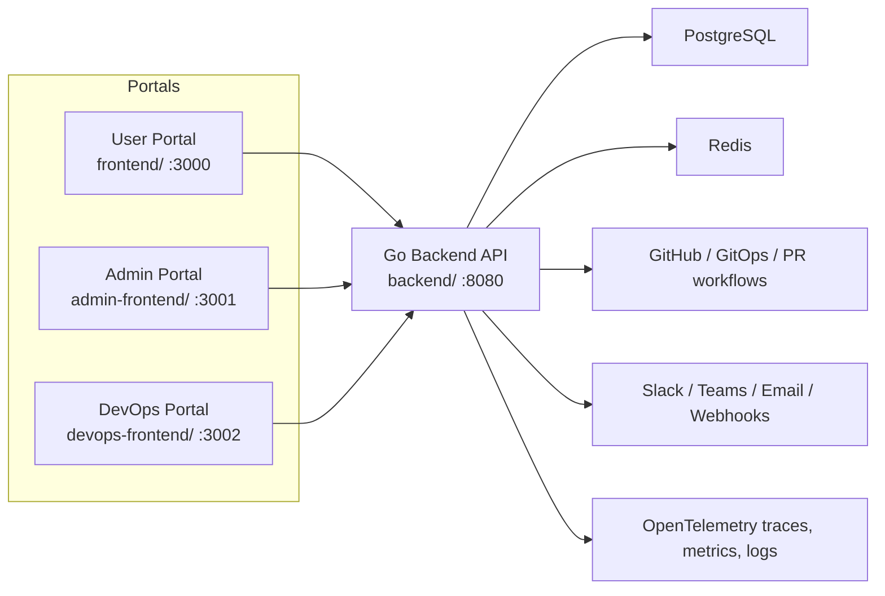
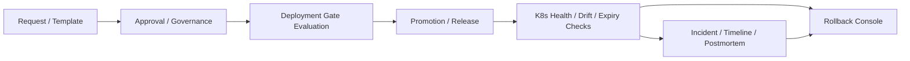

# InfraGate

[](https://go.dev/)
[](https://nextjs.org/)
[](./docs/DEPLOYMENT.md)
[](./docs/CICD.md)
[](./docs/README.md)

InfraGate is a cloud-agnostic self-service infrastructure and operations platform built for teams that need one place to request infrastructure, govern change, manage approvals, operate Kubernetes workloads, track credentials, and respond to incidents.

**Short description:** InfraGate helps platform, DevOps, and governance teams replace fragmented request, approval, release, and incident workflows with one shared control plane.

It combines three portals with one backend control plane:

- `frontend/`: User Portal for self-service requests, templates, incidents, and request history
- `admin-frontend/`: Admin Portal for governance, user/team management, approvals, and platform administration
- `devops-frontend/`: DevOps Portal for operational control, release workflows, reliability, and incident response
- `backend/`: Go API and workflow engine backed by PostgreSQL and Redis

## Start Here

If you are new to the repo, use this order:

1. [Repository docs index](./docs/README.md)
2. [Architecture](./docs/ARCHITECTURE.md)
3. [Tech Stack](./docs/TECH_STACK.md)
4. [Deployment](./docs/DEPLOYMENT.md)
5. [Configuration](./docs/CONFIGURATION.md)
6. [CI/CD](./docs/CICD.md)
7. [Contributing](./CONTRIBUTING.md)
8. [Security policy](./SECURITY.md)
9. [Support](./SUPPORT.md)
10. [Code of Conduct](./CODE_OF_CONDUCT.md)

## What Problem InfraGate Solves

InfraGate is designed to replace fragmented operational workflows spread across email, spreadsheets, chat threads, wiki pages, and manually updated tickets.

With InfraGate, teams can:

- request infrastructure through a governed self-service flow
- manage approvals and release gates with auditability
- monitor delivery health, environment drift, workload state, and certificate/secret expiry
- coordinate incidents, ownership, rollback, and postmortem work in one system
- expose platform operations to the right audience without giving every team raw infrastructure access

## Who InfraGate Is For

InfraGate is useful for:

- platform engineering teams that want governed self-service instead of inbox-driven requests
- DevOps or SRE teams that need visibility into promotions, release risk, and operational health
- admins and governance owners who need auditable approvals, user/team control, and policy enforcement
- application teams that need a simpler way to request infrastructure and follow operational actions without direct cluster access

## What You Can Achieve With It

- Standardize infrastructure request intake across teams and environments
- Reduce manual handoffs between requesters, admins, and DevOps engineers
- Enforce safer promotions with gates, approvals, and risk visibility
- Detect operational issues before they turn into failed releases
- Track incident ownership with generated incident references such as `INC0000123`
- Improve auditability for approvals, incidents, rollbacks, and operational actions

## Portal Overview

| Portal | Primary Audience | What It Handles |
| --- | --- | --- |
| User Portal | Application teams, developers, team leads | Self-service requests, templates, request history, assigned incidents, notifications |
| Admin Portal | Platform admins, governance owners | Users, teams, approvals, governance views, templates, administrative workflows |
| DevOps Portal | SRE, DevOps, platform engineers | Promotions, deployment gates, K8s health, expiry tracking, drift, incidents, rollback, ops command center |

## Core Capabilities

### Self-Service and Governance

- multi-cloud request intake for AWS, GCP, and Azure
- request templates and repeatable onboarding flows
- team-aware request submission and assignment
- approval workflows with SLA support
- audit-friendly change and governance views

### Release and Change Safety

- project-wise release dashboard
- deployment gate policy engine
- persisted gate approvals, expiry, revoke flow, and approval audit
- change risk scoring
- rollback console

### Operational Visibility

- Kubernetes workload health summary
- environment drift detection
- secret and certificate expiry tracking
- project dependency map
- ops command center

### Incident and Reliability Workflow

- incident creation with generated `INC...` references
- team selection and member assignment
- draft and submit incident flows
- incident timeline and postmortem workspace
- user-portal visibility for assigned incidents

### Notification and Analytics

- in-app notification drawers across all portals
- notification settings and approval/notification analytics
- workflow notifications for expiring items, blocked promotions, and approval lifecycle events

## Architecture

Architecture diagrams are available in two places:

- the quick diagrams below for a fast overview
- the full set in [docs/ARCHITECTURE.md](./docs/ARCHITECTURE.md), including the whole-app flow, workflow lifecycle, deployment topology, and high-level system view



## Operating Flow



For the full end-to-end application flow, including how all three portals interact with the backend and shared workflow objects, see [Architecture](./docs/ARCHITECTURE.md).

## Repository Layout

```text
devops_project/
├── admin-frontend/       # Next.js admin portal
├── backend/              # Go backend API, workflows, migrations
├── config/               # Environment configuration
├── devops-frontend/      # Next.js DevOps portal
├── docs/                 # Supporting documentation
├── frontend/             # Next.js user portal
├── scripts/              # Helper scripts (env sync)
├── docker-compose.yml    # Local and profile-based stack orchestration
├── Makefile              # Common developer and ops commands
└── README.md             # This file
```

## Prerequisites

For local development or validation:

- Docker and Docker Compose
- Go `1.25.x`
- Node.js `20.x`
- npm `10.x`

## Quick Start

### 1. Configure the environment

```bash
cp config/.env.example config/.env
./scripts/sync-env.sh
```

Edit `config/.env` with your real values for:

- database connection
- GitHub owner, repo, and token
- frontend/backend URLs
- SMTP or webhook destinations if you want notifications enabled

### 2. Start the stack

Development profile:

```bash
docker-compose --profile dev up -d --build
```

Production-like profile:

```bash
docker-compose --profile prod up -d --build
```

### 3. Open the apps

- User Portal: `http://localhost:3000`
- Admin Portal: `http://localhost:3001`
- DevOps Portal: `http://localhost:3002`
- Backend API: `http://localhost:8080`

## Root Makefile

The root `Makefile` gives you a single place to run the common workflows across the repo.

Examples:

```bash
make help
make env-sync
make backend-test
make frontend-build
make admin-build
make devops-build
make compose-dev
make compose-prod
make compose-down
make helm-template
```

See `make help` for the full command list.

## Helm Deployment

InfraGate now includes a Helm chart at [`helm/infragate`](./helm/infragate) for Kubernetes-style deployment.

The chart includes:

- backend deployment and service
- user, admin, and DevOps frontend deployments and services
- one shared frontend ingress for all portals
- one dedicated backend ingress for the API
- ConfigMaps for non-secret environment values
- Secrets for sensitive environment values

Quick examples:

```bash
make helm-template
make helm-upgrade
```

Detailed deployment steps:

- [`docs/DEPLOYMENT.md`](./docs/DEPLOYMENT.md)
- [`docs/CICD.md`](./docs/CICD.md)
- [`helm/infragate/README.md`](./helm/infragate/README.md)

## Key Developer Workflows

### Backend

```bash
make backend-deps
make backend-test
make backend-build
```

### User Portal

```bash
make frontend-install
make frontend-build
make frontend-lint
```

### Admin Portal

```bash
make admin-install
make admin-build
make admin-lint
```

### DevOps Portal

```bash
make devops-install
make devops-build
make devops-lint
```

## Deployment Notes

- `backend` under the `dev` profile runs with `Dockerfile.dev`
- `backend-prod` under the `prod` or `default` profile runs the compiled backend image
- `frontend`, `admin-frontend`, and `devops-frontend` are separately deployable
- migrations are executed by the backend at startup; keep backend and database schema in sync during rollout

## Configuration and Security Notes

InfraGate relies on `config/.env` for runtime configuration. Before any shared or production deployment:

- replace all placeholder or fallback secrets with real values
- set `NEXT_PUBLIC_API_URL` to the browser-reachable backend URL
- review webhook and SMTP settings
- verify GitHub access tokens and repository targets

Important: the active `docker-compose.yml` currently contains fallback environment defaults for items such as SMTP, GitHub, and webhook URLs. Treat those as local bootstrap values only. Override them from `config/.env` or your secret manager before any real deployment.

## Documentation

The repo docs are intentionally kept small, current, and role-oriented.

- [`docs/README.md`](./docs/README.md)
- [`docs/DEPLOYMENT.md`](./docs/DEPLOYMENT.md)
- [`docs/CONFIGURATION.md`](./docs/CONFIGURATION.md)
- [`docs/ARCHITECTURE.md`](./docs/ARCHITECTURE.md)
- [`docs/TECH_STACK.md`](./docs/TECH_STACK.md)
- [`docs/CICD.md`](./docs/CICD.md)
- [`docs/TROUBLESHOOTING.md`](./docs/TROUBLESHOOTING.md)
- [`CONTRIBUTING.md`](./CONTRIBUTING.md)
- [`SECURITY.md`](./SECURITY.md)
- [`SUPPORT.md`](./SUPPORT.md)
- [`CODE_OF_CONDUCT.md`](./CODE_OF_CONDUCT.md)

## Support

For help using or contributing to InfraGate:

- start with [`docs/README.md`](./docs/README.md)
- use [`SUPPORT.md`](./SUPPORT.md) for support and issue-routing guidance
- use [`SECURITY.md`](./SECURITY.md) for private security reporting

## Community

If you plan to accept outside contributions, these files are now in place:

- [`CONTRIBUTING.md`](./CONTRIBUTING.md)
- [`CODE_OF_CONDUCT.md`](./CODE_OF_CONDUCT.md)
- [`SECURITY.md`](./SECURITY.md)

## Troubleshooting

### Frontend cannot connect to backend

Check these first:

- backend container is running
- `NEXT_PUBLIC_API_URL` points to a URL the browser can reach
- port `8080` is open and reachable
- frontend images were rebuilt after changing environment values

Useful checks:

```bash
docker ps --format '{{.Names}} {{.Ports}}'
curl -s http://localhost:8080/health
```

### Build failures in a frontend

Run the build directly for the affected portal:

```bash
make frontend-build
make admin-build
make devops-build
```

If the error is type-related, fix the first failing file and rerun. Next.js strict builds usually surface issues one at a time.

### Notifications are not being delivered

Check:

- SMTP or webhook values in `config/.env`
- backend logs
- Redis availability if background jobs are enabled

## Why Teams Adopt InfraGate

- fewer manual tickets and handoffs
- clearer ownership between requesters, admins, and DevOps
- safer change control with operational context
- better visibility into drift, reliability, and release readiness
- stronger auditability for platform operations

## License

This repository does not currently include a published open-source license file.

Before publishing InfraGate as an open-source project, add a root `LICENSE` file with the license you want contributors and users to operate under.
