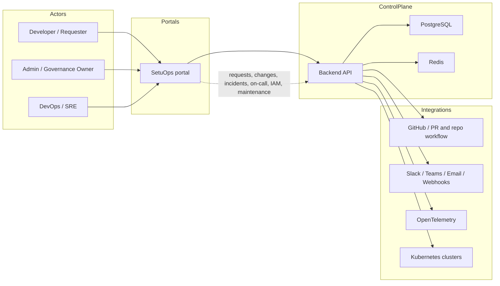
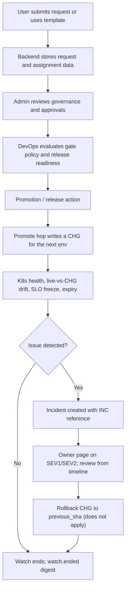
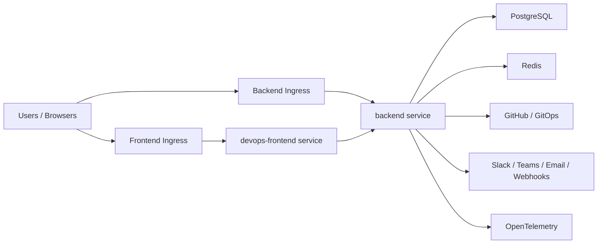
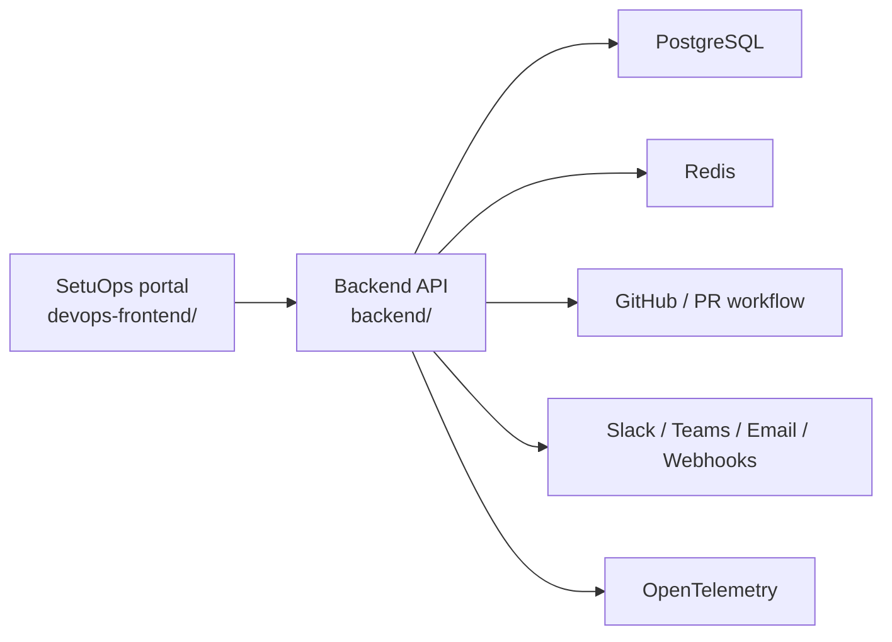

# Architecture

SetuOps is one web portal (`devops-frontend`) and one Go API. Requesters, operators, managers, and admins share that shell. Section grants decide what they see. The diagrams below that still say “three portals” describe the earlier split; the current screen flows are in [FLOWS.md](./FLOWS.md).

## Diagram Index

This document contains four architecture views:

1. `Whole App Flow`: how users, portals, backend, and integrations connect
2. `Workflow Lifecycle`: how requests move into approvals, promotions, incidents, and rollback
3. `Deployment Topology`: how the app is exposed through the two-ingress model
4. `High-Level View`: a compact summary for quick orientation

If you are reading this in GitHub, all diagrams below should render directly. If they do not, check whether Mermaid rendering is disabled in your viewer.

## Whole App Flow

This diagram shows the full product flow from request intake through operations and incident handling.

## Workflow Lifecycle

This diagram shows how the major workflow objects move through the system.

## Deployment Topology

This diagram shows the runtime the repo ships: one portal and one API. Helm values still name extra frontend hosts from the earlier split. Those folders are not in this tree.

## High-Level View

## Components

### Portal

`devops-frontend` is the only UI. Grants split it into:

- Requests: infrastructure requests, templates, history, projects, teams
- Daily: overview, my work, service desk (changes, incidents, problems, knowledge), services
- Operations: on-call, maintenance windows, inbound webhooks, guides, alerts
- Infrastructure: projects, environments, cloud accounts, inventory, IAM access, Kubernetes, releases
- Security: scans, findings, secrets
- Records: previews, scorecards, evidence, request templates
- Portal Access: people, groups, sign-in (admins)

Screen-level behavior for on-call, IAM, changes, incidents, problems, maintenance, and webhooks is in [FLOWS.md](./FLOWS.md).

### Backend API

The backend is the workflow engine for that portal. It manages:

- authentication and session handling
- PostgreSQL persistence
- Redis-backed caching and background jobs
- GitHub integration and PR workflows
- incident, approval, and audit workflows
- notifications and observability

## Shared Data and Workflow Objects

Across the app, these objects are the most important:

- requests
- approvals and gate approvals
- change requests (including preview graduate and promote hops)
- incidents, generated reviews, and postmortems
- problems and knowledge articles
- on-call rotations, project teams, and cover requests
- maintenance windows (`pending_manager` → `pending_devops` → `pending_admin`)
- IAM access requests (in memory until restart; grant only after the access-file callback)
- promotions, SLO freezes, and rollback CHGs
- teams and assignments
- K8s health findings and live-vs-CHG drift
- identity findings (OIDC / cloud-role exchange, no secrets)
- expiry and notification events (`watch.ended`, `incident.owner_paged`)

Those objects are what the one portal reads and writes.

## Ports

| Component | Default Port |
| --- | --- |
| Backend API | `8080` |
| SetuOps portal | `3002` |

## Helm Ingress Model

The Helm chart creates two ingress resources:

1. **Frontend ingress**
   - the chart values still list `portal`, `admin`, and `devops` hosts. The app in this repo is `devops-frontend`.
2. **Backend ingress**
   - exposes the API on a separate host such as `api.example.com`

This separation keeps the browser-facing portals together while still allowing the API to live on its own hostname.

## Runtime Dependencies

- PostgreSQL for persistent storage
- Redis for cache and lightweight background jobs
- GitHub for PR-based workflows
- Optional SMTP / Slack / Teams / webhook integrations
- Optional OpenTelemetry collector endpoint
