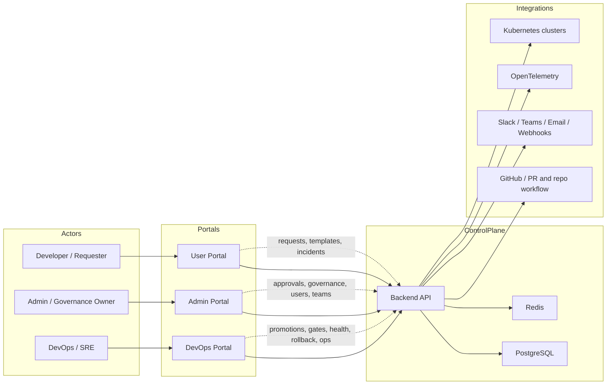
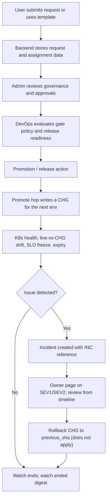
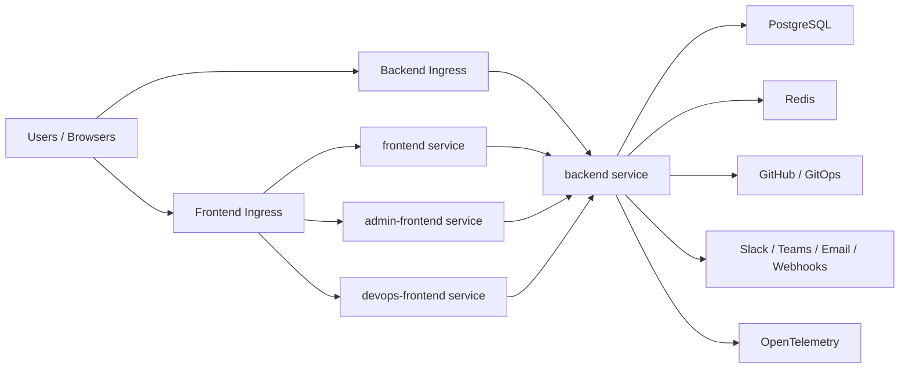
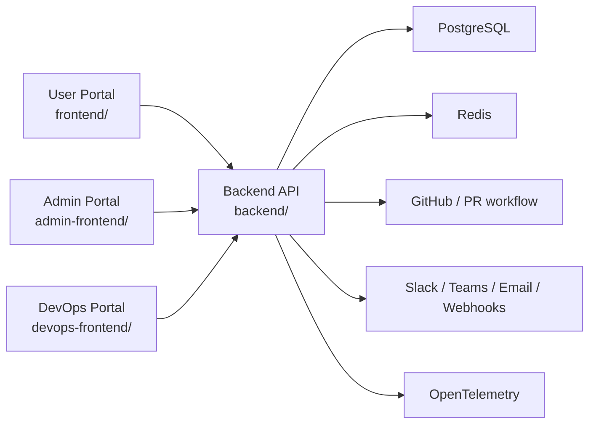

# Architecture

InfraGate is built as a shared control plane with three separate web portals backed by one Go API.

## Diagram Index

This document contains four architecture views:

1. `Whole App Flow`: how users, portals, backend, and integrations connect
2. `Workflow Lifecycle`: how requests move into approvals, promotions, incidents, and rollback
3. `Deployment Topology`: how the app is exposed through the two-ingress model
4. `High-Level View`: a compact summary for quick orientation

If you are reading this in GitHub, all diagrams below should render directly. If they do not, check whether Mermaid rendering is disabled in your viewer.

## Whole App Flow

This diagram shows the full product flow from request intake through operations and incident handling.

## Workflow Lifecycle

This diagram shows how the major workflow objects move through the system.

## Deployment Topology

This diagram shows the runtime exposure model used by Docker/Helm deployments: one ingress for all frontends and one separate ingress for the backend API.

## High-Level View

## Components

### User Portal

The user portal is the self-service entry point for:

- infrastructure requests
- reusable templates
- request history
- assigned incidents and read-only reviews
- scorecards and live-vs-CHG drift on visible projects
- notifications

### Admin Portal

The admin portal is used for:

- user and team management
- governance and approval views
- template management
- outbound webhook subscriptions (`watch.ended`, `incident.owner_paged`)
- read catalogs for changes, incidents, scorecards, and reviews
- administrative workflows

### DevOps Portal

The DevOps portal is used for:

- promotions (each hop writes a CHG) and release gates
- Health, SLO deploy freeze, and live-vs-CHG drift
- Identity (OIDC verify + last cloud-role exchange)
- Kubernetes, expiry, dependency, and risk analysis
- incidents, generated reviews, rollback CHG, and command-center operations
- MCP catalog reads plus comment / request-rollback (no apply)

### Backend API

The backend is the shared workflow engine for all three portals. It manages:

- authentication and session handling
- PostgreSQL persistence
- Redis-backed caching and background jobs
- GitHub integration and PR workflows
- incident, approval, and audit workflows
- notifications and observability

## Shared Data and Workflow Objects

Across the app, these objects are the most important:

- requests
- approvals and gate approvals
- change requests (including preview graduate and promote hops)
- incidents, generated reviews, and postmortems
- promotions, SLO freezes, and rollback CHGs
- teams and assignments
- K8s health findings and live-vs-CHG drift
- identity findings (OIDC / cloud-role exchange, no secrets)
- expiry and notification events (`watch.ended`, `incident.owner_paged`)

That shared object model is the main reason all three portals can work as one system instead of separate apps.

## Ports

| Component | Default Port |
| --- | --- |
| Backend API | `8080` |
| User Portal | `3000` |
| Admin Portal | `3001` |
| DevOps Portal | `3002` |

## Helm Ingress Model

The Helm chart creates two ingress resources:

1. **Frontend ingress**
   - routes `portal`, `admin`, and `devops` hosts to the correct frontend services
2. **Backend ingress**
   - exposes the API on a separate host such as `api.example.com`

This separation keeps the browser-facing portals together while still allowing the API to live on its own hostname.

## Runtime Dependencies

- PostgreSQL for persistent storage
- Redis for cache and lightweight background jobs
- GitHub for PR-based workflows
- Optional SMTP / Slack / Teams / webhook integrations
- Optional OpenTelemetry collector endpoint
