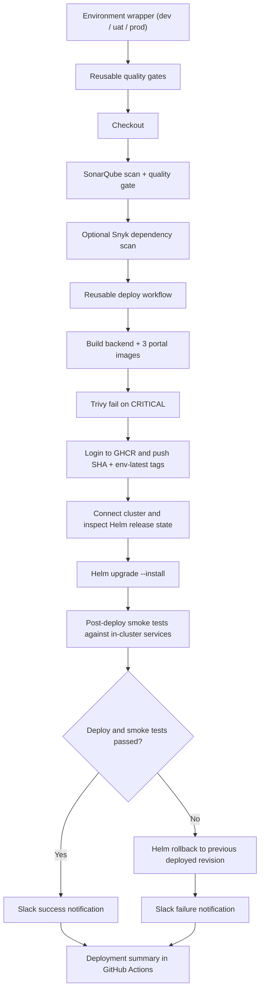

# CI/CD Deployment Pipelines

This repository includes environment-specific GitHub Actions deployment pipelines that publish Docker images to GitHub Container Registry (GHCR) and deploy the platform through Helm.

The pipeline is intentionally centralized in two reusable layers:

- [`.github/workflows/quality-gates-reusable.yaml`](../.github/workflows/quality-gates-reusable.yaml): code-quality and security gates
- [`.github/workflows/deploy-reusable.yaml`](../.github/workflows/deploy-reusable.yaml): image build, registry publish, Helm deploy, rollback, and notifications

## Workflow Layout

- [`.github/workflows/quality-gates-reusable.yaml`](../.github/workflows/quality-gates-reusable.yaml): shared quality-gate workflow
- [`.github/workflows/deploy-reusable.yaml`](../.github/workflows/deploy-reusable.yaml): shared deployment pipeline
- [`.github/workflows/deploy-dev.yaml`](../.github/workflows/deploy-dev.yaml): dev deployment wrapper
- [`.github/workflows/deploy-uat.yaml`](../.github/workflows/deploy-uat.yaml): uat deployment wrapper
- [`.github/workflows/deploy-prod.yaml`](../.github/workflows/deploy-prod.yaml): prod deployment wrapper
- [`.github/action/sonar-project.properties`](../.github/action/sonar-project.properties): SonarQube project configuration used by the pipeline

## Centralized Pipeline Flow



## Pipeline Structure

Each environment pipeline follows the same gated path:

1. Checkout code
2. Run quality gates
   - SonarQube scan
   - SonarQube quality gate
   - optional Snyk dependency scan
3. Build Docker images locally
4. Run Trivy on the built images and fail on `CRITICAL`
5. Log in to GHCR with GitHub secrets
6. Push versioned and environment-latest images to GHCR
7. Connect to the target Kubernetes cluster
8. Show current Helm client and release state
9. Run `helm upgrade --install`
10. Run post-deploy smoke tests against backend and all three frontends from inside the cluster
11. Send a Slack success message
12. If deployment or smoke tests fail, roll back to the last deployed Helm revision when one exists
13. Send a Slack failure message
14. Write a deployment summary into the GitHub Actions run

## Environments and Triggers

| Workflow | Trigger | GitHub Environment | Notes |
| --- | --- | --- | --- |
| `deploy-dev.yaml` | manual dispatch | `dev` | Fast-moving environment |
| `deploy-uat.yaml` | manual dispatch | `uat` | Validation environment |
| `deploy-prod.yaml` | manual dispatch with release notes | `prod` | Protected environment with approval gate |

At the moment, all three deployment workflows are manual-only. Pushing to `dev`, `uat`, or any other branch will not automatically start a deployment.

## Production Approval

Configure the GitHub Environment named `prod` with required reviewers. The reusable workflow sets the deploy job environment dynamically, so GitHub pauses the production deployment until approval is granted.

Recommended GitHub Environment protection for `prod`:

- required reviewers enabled
- prevent self-review if your org policy needs it
- environment-scoped secrets and vars

The production wrapper also requires `release_notes` as part of the manual dispatch. Those notes are carried into the deployment summary and Slack notifications so the approval context stays attached to the release.

## Registry Strategy

Images are published to GHCR using this naming pattern:

- `ghcr.io/<owner>/<repo>-backend`
- `ghcr.io/<owner>/<repo>-frontend`
- `ghcr.io/<owner>/<repo>-admin-frontend`
- `ghcr.io/<owner>/<repo>-devops-frontend`

Tags pushed per run:

- commit SHA
- `<environment>-latest`

## Why SonarQube and Snyk

We do not strictly need both.

- **SonarQube** is the primary required quality gate here. It is used for code quality, bug patterns, and SAST-style code analysis with a quality gate decision.
- **Snyk** is optional in this setup. It is useful mainly for dependency and package risk visibility.
- **Trivy** is the required container/image gate and is what blocks deployment on critical image vulnerabilities.

The simplified model is:

- SonarQube: required
- Trivy: required
- Snyk: optional enhancement

If you want to keep the pipeline lean, you can leave `SNYK_TOKEN` unset and the workflow will skip Snyk automatically.

## Required GitHub Secrets

Set these in repository or environment secrets.

### Mandatory for all environments

| Secret | Purpose |
| --- | --- |
| `GHCR_USERNAME` | GHCR login username |
| `GHCR_PASSWORD` | GHCR login password or PAT with package write/read |
| `KUBECONFIG_B64` | Base64-encoded kubeconfig for the target cluster |
| `SONAR_TOKEN` | SonarQube authentication |
| `DATABASE_URL` | Preferred backend database connection string for Supabase or managed Postgres |
| `DB_PASSWORD` | Backend database password when using split `DB_*` configuration |
| `GITHUB_TOKEN` | GitHub integration token used by the backend |
| `ADMIN_SECRET` | Backend admin secret |
| `DEFAULT_ADMIN_PASSWORD` | Initial admin password |

### Optional but recommended

| Secret | Purpose |
| --- | --- |
| `SMTP_PASSWORD` | SMTP auth |
| `CI_WEBHOOK_SECRET` | CI webhook auth |
| `CHANGE_WEBHOOK_SECRET` | App merge change-request webhook auth |
| `ALERT_WEBHOOK_SECRET` | Grafana / logger incident webhook auth |
| `SNYK_TOKEN` | Optional Snyk authentication for dependency scanning |
| `SLACK_WEBHOOK_URL` | Success/failure notifications |
| `TEAMS_WEBHOOK_URL` | Teams integration |
| `OPS_NOTIFICATION_WEBHOOK_URL` | Generic ops notification webhook |
| `API_KEY_HASH_SECRET` | API key hashing |
| `API_KEY_PEPPER` | API key pepper |
| `JWT_SECRET` | JWT signing |
| `SSO_AUTH_SHARED_SECRET` | Shared SSO auth secret |
| `AZURE_DIRECTORY_USERS_JSON` | Optional Azure directory sync payload |
| `KEYCLOAK_DIRECTORY_USERS_JSON` | Optional Keycloak directory sync payload |
| `SAML_DIRECTORY_USERS_JSON` | Optional SAML directory sync payload |
| `SSO_DIRECTORY_USERS_JSON` | Optional generic SSO directory sync payload |
| `SSO_BREAK_GLASS_USERS` | Optional break-glass SSO users |

## Required GitHub Variables

Use repository variables for shared defaults or environment variables when they differ by environment.

| Variable | Purpose |
| --- | --- |
| `SONAR_HOST_URL` | SonarQube server URL |
| `NEXT_PUBLIC_API_URL` | Public backend URL used by all portals |
| `FRONTEND_HOST` | User portal ingress host |
| `ADMIN_FRONTEND_HOST` | Admin portal ingress host |
| `DEVOPS_FRONTEND_HOST` | DevOps portal ingress host |
| `BACKEND_HOST` | Backend ingress host |
| `FRONTEND_URL` | Full user portal URL |
| `DEVOPS_FRONTEND_URL` | Full DevOps portal URL |
| `INGRESS_CLASS` | Ingress class, such as `nginx` |
| `GITHUB_OWNER` | Backend GitHub owner setting |
| `GITHUB_REPO` | Backend GitHub repo setting |
| `BASE_BRANCH` | Default branch used by backend workflows |
| `DB_HOST` | Database host |
| `DB_PORT` | Database port |
| `DB_USER` | Database user |
| `DB_NAME` | Database name |
| `DB_SSLMODE` | Database SSL mode |
| `DB_SSLROOTCERT` | Optional CA certificate path for managed Postgres TLS verification |
| `DB_CONNECT_TIMEOUT_SECONDS` | Backend DB connect timeout |
| `REDIS_ADDR` | Redis address |
| `REDIS_DB` | Redis database index |
| `REDIS_CACHE_TTL_SECONDS` | Cache TTL |
| `REDIS_QUEUE_NAME` | Queue key |
| `REDIS_JOB_POLL_TIMEOUT_SECONDS` | Queue poll timeout |
| `DB_QUERY_TIMEOUT_SECONDS` | DB query timeout |
| `DB_SLOW_QUERY_MS` | Slow query threshold |
| `REQUEST_LOG_SLOW_MS` | Slow request threshold |
| `DEFAULT_ADMIN_USERNAME` | Seed admin username |
| `DEFAULT_ADMIN_EMAIL` | Seed admin email |
| `SESSION_TIMEOUT_MINUTES` | Session timeout |
| `SMTP_HOST` | SMTP host |
| `SMTP_PORT` | SMTP port |
| `SMTP_USER` | SMTP username |
| `SMTP_FROM` | SMTP from address |
| `SMTP_USE_TLS` | SMTP TLS flag |
| `WEBHOOK_APPROVE_URL` | Approval webhook URL |
| `SSO_LOGIN_URL` | Generic SSO login URL |
| `AZURE_SSO_LOGIN_URL` | Azure SSO login URL |
| `KEYCLOAK_SSO_LOGIN_URL` | Keycloak SSO login URL |
| `SAML_SSO_LOGIN_URL` | SAML SSO login URL |
| `OTEL_ENABLED` | OpenTelemetry enable flag |
| `OTEL_SERVICE_ENV` | OpenTelemetry environment |
| `OTEL_EXPORTER_OTLP_ENDPOINT` | OTLP endpoint |
| `OTEL_EXPORTER_OTLP_INSECURE` | OTLP insecure flag |
| `OTEL_TRACES_SAMPLER_RATIO` | Trace sample ratio |
| `OTEL_METRICS_EXPORT_INTERVAL_SECONDS` | Metrics export interval |
| `ALLOW_START_WITHOUT_DB` | Backend startup override for non-DB environments |

## Change and alert webhooks

After merge to `main`, CI should POST `/api/webhooks/change` with `X-CI-Secret` or `X-Hub-Signature-256`. Omit `environment` so SetuOps fills service, project, and env from the Services catalog when the repo matches. Idempotency is `repo + sha + resolved environment`. Grafana, Alertmanager, or a logger POSTs `/api/webhooks/alerts`. Optional post-deploy samples go to `/api/webhooks/watch-metrics`. Do not store these secrets in git.

**GitHub secrets:** `SETUOPS_API_URL`, `CHANGE_WEBHOOK_SECRET` (same value as Admin → Webhooks → inbound change secret).

**Portal lifecycle vs CI:** In DevOps, operators **Approve** (→ `scheduled`) and **Start implementation** when CAB applies. CI updates the same CHG with `status` (`implementing` → `implemented`) using the same `repo`, `sha`, and resolved environment. Map PR/release notes to JSON **`summary`**.

### Single POST after successful deploy

```yaml
- name: Record SetuOps change
  if: success() && github.ref == 'refs/heads/main'
  env:
    SETUOPS_API: ${{ secrets.SETUOPS_API_URL }}
    SETUOPS_SECRET: ${{ secrets.CHANGE_WEBHOOK_SECRET }}
    CHANGE_TITLE: ${{ github.event.head_commit.message }}
    CHANGE_SUMMARY: ${{ github.event.pull_request.body || github.event.head_commit.message }}
    CHANGE_AUTHOR: ${{ github.actor }}
    PR_NUMBER: ${{ github.event.pull_request.number || 0 }}
    PR_URL: ${{ github.event.pull_request.html_url || '' }}
  run: |
    set -euo pipefail
    SERVICE="${GITHUB_REPOSITORY##*/}"
    TITLE="$(printf '%s' "$CHANGE_TITLE" | head -n1)"
    SUMMARY="$(printf '%s' "$CHANGE_SUMMARY" | head -c 8000)"
    curl -sf -X POST "${SETUOPS_API%/}/api/webhooks/change" \
      -H "Content-Type: application/json" \
      -H "X-CI-Secret: $SETUOPS_SECRET" \
      --data "$(jq -n \
        --arg repo "$GITHUB_REPOSITORY" \
        --arg sha "$GITHUB_SHA" \
        --arg previous_sha "${GITHUB_EVENT_BEFORE:-}" \
        --arg service "$SERVICE" \
        --arg title "$TITLE" \
        --arg summary "$SUMMARY" \
        --arg author "$CHANGE_AUTHOR" \
        --arg pr_url "$PR_URL" \
        --arg pipeline_url "$GITHUB_SERVER_URL/$GITHUB_REPOSITORY/actions/runs/$GITHUB_RUN_ID" \
        --arg status "implemented" \
        --arg sbom_url "${SBOM_URL:-}" \
        --arg attestation_url "${ATTESTATION_URL:-}" \
        --arg image_digest "${IMAGE_DIGEST:-}" \
        --argjson pr_number "${PR_NUMBER:-0}" \
        --argjson infracost_report "${INFRACOST_REPORT:-null}" \
        '{
          repo: $repo,
          sha: $sha,
          previous_sha: $previous_sha,
          service: $service,
          title: $title,
          summary: $summary,
          author: $author,
          pr_number: $pr_number,
          pr_url: $pr_url,
          pipeline_url: $pipeline_url,
          status: $status,
          change_type: "standard",
          priority: "medium",
          risk_level: "medium",
          watch_minutes: 120,
          sbom_url: $sbom_url,
          attestation_url: $attestation_url,
          image_digest: $image_digest,
          infracost_report: $infracost_report
        }')"
```

### Two-phase POST (deploy start + deploy finish)

Use the same `repo` and `sha` for both calls so SetuOps upserts one CHG.

```yaml
      - name: SetuOps — deploy started
        if: success() && github.ref == 'refs/heads/main'
        env:
          SETUOPS_API: ${{ secrets.SETUOPS_API_URL }}
          SETUOPS_SECRET: ${{ secrets.CHANGE_WEBHOOK_SECRET }}
          CHANGE_TITLE: ${{ github.event.head_commit.message }}
          CHANGE_SUMMARY: ${{ github.event.pull_request.body || github.event.head_commit.message }}
          CHANGE_AUTHOR: ${{ github.actor }}
          PR_URL: ${{ github.event.pull_request.html_url || '' }}
        run: |
          set -euo pipefail
          SERVICE="${GITHUB_REPOSITORY##*/}"
          TITLE="$(printf '%s' "$CHANGE_TITLE" | head -n1)"
          SUMMARY="$(printf '%s' "$CHANGE_SUMMARY" | head -c 8000)"
          curl -sf -X POST "${SETUOPS_API%/}/api/webhooks/change" \
            -H "Content-Type: application/json" \
            -H "X-CI-Secret: $SETUOPS_SECRET" \
            --data "$(jq -n \
              --arg repo "$GITHUB_REPOSITORY" \
              --arg sha "$GITHUB_SHA" \
              --arg service "$SERVICE" \
              --arg title "$TITLE" \
              --arg summary "$SUMMARY" \
              --arg author "$CHANGE_AUTHOR" \
              --arg pr_url "$PR_URL" \
              --arg pipeline_url "$GITHUB_SERVER_URL/$GITHUB_REPOSITORY/actions/runs/$GITHUB_RUN_ID" \
              --arg status "implementing" \
              '{ repo: $repo, sha: $sha, service: $service, title: $title, summary: $summary,
                 author: $author, pr_url: $pr_url, pipeline_url: $pipeline_url, status: $status,
                 change_type: "standard", watch_minutes: 120 }')"

      # … deploy steps …

      - name: SetuOps — deploy finished
        if: success() && github.ref == 'refs/heads/main'
        env:
          SETUOPS_API: ${{ secrets.SETUOPS_API_URL }}
          SETUOPS_SECRET: ${{ secrets.CHANGE_WEBHOOK_SECRET }}
          CHANGE_AUTHOR: ${{ github.actor }}
        run: |
          set -euo pipefail
          curl -sf -X POST "${SETUOPS_API%/}/api/webhooks/change" \
            -H "Content-Type: application/json" \
            -H "X-CI-Secret: $SETUOPS_SECRET" \
            --data "$(jq -n \
              --arg repo "$GITHUB_REPOSITORY" \
              --arg sha "$GITHUB_SHA" \
              --arg service "${GITHUB_REPOSITORY##*/}" \
              --arg author "$CHANGE_AUTHOR" \
              --arg pipeline_url "$GITHUB_SERVER_URL/$GITHUB_REPOSITORY/actions/runs/$GITHUB_RUN_ID" \
              --arg status "implemented" \
              '{ repo: $repo, sha: $sha, service: $service, author: $author,
                 pipeline_url: $pipeline_url, status: $status, change_type: "standard", watch_minutes: 120 }')"

      - name: SetuOps — deploy failed
        if: failure() && github.ref == 'refs/heads/main'
        env:
          SETUOPS_API: ${{ secrets.SETUOPS_API_URL }}
          SETUOPS_SECRET: ${{ secrets.CHANGE_WEBHOOK_SECRET }}
        run: |
          curl -sf -X POST "${SETUOPS_API%/}/api/webhooks/change" \
            -H "Content-Type: application/json" \
            -H "X-CI-Secret: $SETUOPS_SECRET" \
            --data "$(jq -n \
              --arg repo "$GITHUB_REPOSITORY" \
              --arg sha "$GITHUB_SHA" \
              --arg service "${GITHUB_REPOSITORY##*/}" \
              --arg status "failed" \
              '{ repo: $repo, sha: $sha, service: $service, status: $status, change_type: "standard" }')" || true
```

### Local smoke test

```bash
export SETUOPS_API="https://your-api"
export SETUOPS_SECRET="your-inbound-secret"
curl -sf -X POST "$SETUOPS_API/api/webhooks/change" \
  -H "Content-Type: application/json" \
  -H "X-CI-Secret: $SETUOPS_SECRET" \
  -d '{"repo":"org/my-service","sha":"'"$(git rev-parse HEAD)"'","title":"CI sample","summary":"Release notes","author":"you","change_type":"standard","status":"implemented","watch_minutes":120}'
```

## Helm Values Files

The repo includes baseline environment values:

- [`helm/infragate/values-dev.yaml`](../helm/infragate/values-dev.yaml)
- [`helm/infragate/values-uat.yaml`](../helm/infragate/values-uat.yaml)
- [`helm/infragate/values-prod.yaml`](../helm/infragate/values-prod.yaml)

The GitHub Actions workflow layers a generated CI override file on top of these values so image tags, hosts, config, and secrets come from GitHub variables and secrets rather than from committed files.

If your managed Postgres provider requires a CA file:

1. store the certificate in a Secret or ConfigMap
2. mount it with `backend.extraVolumes` and `backend.extraVolumeMounts`
3. set `backend.env.DB_SSLROOTCERT` to the mounted path

## Makefile Helpers

For local Helm validation:

```bash
make helm-template-dev
make helm-template-uat
make helm-template-prod

make helm-upgrade-dev HELM_ARGS="-f my-extra-values.yaml"
make helm-upgrade-uat HELM_ARGS="-f my-extra-values.yaml"
make helm-upgrade-prod HELM_ARGS="-f my-extra-values.yaml"
```

## Rollback Behavior

When a Helm deployment or smoke test fails:

- the workflow checks the release history
- if a previous deployed revision exists, it runs `helm rollback`
- the workflow still ends in failure so the deployment problem remains visible
- Slack receives a failure notification, including the failure stage and whether rollback was attempted

## Smoke Tests

After Helm reports success, the reusable deploy workflow starts a short-lived curl pod in the target namespace and verifies:

- backend health: `GET /health`
- user portal root page
- admin portal root page
- DevOps portal root page

This keeps the smoke test independent of ingress TLS and validates the services from inside the cluster network.

## Recommended Extras

These are not mandatory, but they make the pipeline stronger:

- use GitHub branch protection so only green checks can merge
- scope secrets and variables by environment
- rotate GHCR and cluster credentials regularly
- keep production manual unless your release process requires automatic promotion
- add post-deploy smoke tests later if you want application-level verification
