# DevOps Tool – Total Workflow

View this file in **GitHub**, **VS Code** (with Mermaid extension), or paste the code block into https://mermaid.live to edit/export.

```mermaid
flowchart TB
    subgraph Users["Users & Portals"]
        Admin["Admin (admin role)"]
        DevOps["DevOps User (devops_user)"]
        DevOpsMgr["DevOps Manager (is_devops_manager)"]
        PortalUser["Portal User (portal_user)"]
        PortalMgr["Portal Manager (is_portal_manager)"]
        AdminPortal["Admin Portal: Dashboard, Users, Teams, Requests, Notifications"]
        DevOpsPortal["DevOps Portal: My tickets, Workload (managers: pending count)"]
        FrontendPortal["User / Frontend Portal: Create request, History, Profile"]
    end

    Admin --> AdminPortal
    DevOps --> DevOpsPortal
    DevOpsMgr --> DevOpsPortal
    PortalUser --> FrontendPortal
    PortalMgr --> FrontendPortal

    subgraph Create["Request creation (User / Frontend)"]
        Form["User fills form: team, env, cloud, service, priority, due_date, config"]
        Draft{"Save as draft?"}
        DraftStatus["draft (editable later)"]
        PUM["pending_user_manager_approval (if creator has manager)"]
        PDA["pending_devops_approval (no manager)"]
    end

    Form --> Draft
    Draft -->|Yes| DraftStatus
    Draft -->|No, has manager| PUM
    Draft -->|No, no manager| PDA

    subgraph Lifecycle["Approval & PR lifecycle"]
        draft["draft"]
        pum["pending_user_manager_approval"]
        pda["pending_devops_approval"]
        inprogress["in_progress (PR created)"]
        completed["completed"]
        rejected["rejected"]
    end

    draft -->|Submit| pum
    pum -->|User/Group manager approves| pda
    pda -->|Admin or DevOps manager approves → Create GitHub PR → Assign| inprogress
    inprogress -->|Admin: PATCH status| completed
    inprogress -->|Admin: PATCH status| rejected
    pum -.->|Reject| rejected
    pda -.->|Reject| rejected

    subgraph Legend["Who can do what"]
        L1["Admin: Approve/Reject any pending; move pending_user_manager → pending_devops; Create PR; PATCH status; see all requests & notifications (Ticket #id)."]
        L2["DevOps manager: Approve/Reject only pending_devops_approval (creates PR); Workload page. DevOps user: My tickets."]
        L3["User/Group manager (portal): Approve only pending_user_manager_approval → pending_devops_approval. Portal user: Create request, History."]
    end
```

## Backend (Go API)

- **Auth (JWT)** – Admin / DevOps / User  
- **POST /api/request** – create draft / submit  
- **Admin** – requests, approve, reject, status, notifications  
- **DevOps** – workload, approve (manager)  
- **GitHub** – Create PR (branch, file, config)
